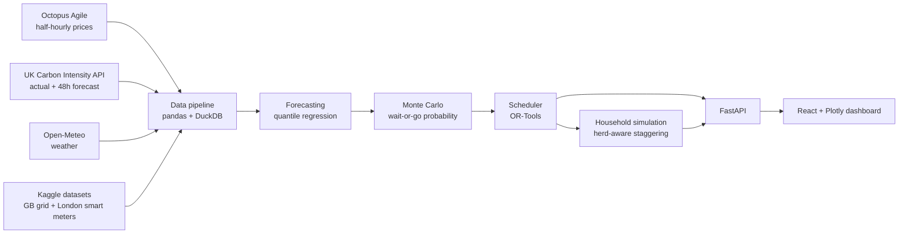

<div align="center">

# ⚡ Tempo

### Run your power at the right time.

**Risk-aware appliance scheduling from electricity price, carbon intensity and weather forecasts.**


*Built at OxHack 2026, University of Oxford.*

</div>

---

## Table of Contents

1. [Overview](#overview)
2. [Hackathon Context](#hackathon-context)
3. [The Problem](#the-problem)
4. [The Solution](#the-solution)
5. [Key Features](#key-features)
6. [How It Works](#how-it-works)
7. [Tech Stack](#tech-stack)
8. [Data Sources](#data-sources)
9. [Project Structure](#project-structure)
10. [Getting Started](#getting-started)
11. [How to Use Tempo](#how-to-use-tempo)
12. [API Reference](#api-reference)
13. [Methodology and Limitations](#methodology-and-limitations)
14. [Skills Learned](#skills-learned)
15. [Roadmap](#roadmap)
16. [Team](#team)
17. [Acknowledgements](#acknowledgements)
18. [License](#license)

---

## Overview

**Tempo** tells you whether to run an appliance **now or wait**, using price, carbon and weather forecasts for the next 24-48 hours.

It gives each recommendation as a **probability with a worst case** (for example: *"84% chance waiting is cheaper, you risk losing 6p"*) and **re-plans as forecasts change**. It also **staggers advice across many households**, so a rush to the cheap hour does not create a new grid peak, and it **back-tests its savings on real historical data**.

---

## Hackathon Context

| | |
|---|---|
| **Event** | OxHack 2026 |
| **Venue** | University of Oxford |
| **Theme** | **Time**: best use of data for predictions and decision making |
| **Format** | Two day build |

### How Tempo answers the theme

Time is the core of the product, not an add-on. Tempo combines time-stamped data with prediction and decision making:

- **Time-series data in:** half-hourly electricity prices, grid carbon intensity and weather.
- **Prediction over time:** forecasts of price and carbon with uncertainty ranges, extended beyond the published price window.
- **Decisions about when:** a scheduler that chooses the best time slot under real deadlines, and a probability that waiting beats starting now.
- **Time-aware validation:** a back-test that replays past half-hours to show what the advice would have saved.

---

## The Problem

Electricity is not equally cheap or clean at every hour. Prices and grid carbon intensity change every half-hour, driven by demand, wind, solar and generation mix. Most households and businesses run flexible loads (dishwashers, washing machines, EV chargers, batch jobs) at whatever time suits them, and pay more and emit more than they need to.

Existing tools mostly stop at showing the cheap or green half-hours. That leaves three gaps:

1. **No uncertainty.** A single "best time" hides the fact that forecasts can be wrong. Users cannot tell whether waiting is worth the risk.
2. **No awareness of crowds.** If thousands of users all move to the same cheap hour, they create a new demand peak and the benefit disappears.
3. **No credible evidence.** Savings are usually claimed, not measured against real historical data.

---

## The Solution

Tempo moves from a price display to a **decision engine under uncertainty**:

- It turns forecasts into a **probability that waiting beats starting now**, plus a worst-case cost.
- It lets users set a **risk appetite** (safe, balanced, aggressive).
- It respects **deadlines and quiet hours** ("ready by 7am, no noise after 11pm").
- It **spreads recommendations across households** to avoid rebound peaks.
- It reports **honest savings** with forecast error shown alongside.

---

## Key Features

| Feature | What it does |
|---|---|
| **Wait-or-Go Engine** | Compares starting now against waiting using Monte Carlo simulation over forecast ranges, and returns a probability and worst case. |
| **Deadline-aware scheduler** | Picks the best valid slots under constraints, including splitting a job across non-contiguous windows. |
| **Cost vs carbon trade-off** | A slider balances the cheapest slot against the greenest slot. |
| **Risk appetite control** | Sets how much forecast uncertainty a recommendation may accept. |
| **Herd-aware simulation** | Simulates many households and compares "everyone picks the cheapest slot" with Tempo's staggered plan. |
| **Savings ledger** | Back-tests Tempo against default behaviour on historical data and reports pounds saved, CO₂ avoided and forecast error. |
| **Live re-planning** | Updates the recommendation as new forecasts arrive and explains what changed. |

---

## How It Works



1. **Ingest:** pull prices, carbon intensity and weather, and join them on a half-hourly UTC timestamp.
2. **Forecast:** quantile models estimate a range (for example the 10th, 50th and 90th percentiles) for price and carbon over the next 24-48 hours.
3. **Simulate:** a Monte Carlo run samples from those ranges to estimate the probability that waiting beats starting now.
4. **Schedule:** a constraint solver chooses the best slot or slots under the user's deadline and quiet hours.
5. **Stagger:** across many simulated households, the planner spreads start times so demand does not pile into a single slot.
6. **Present:** the dashboard shows the recommendation, the probability, the worst case and the savings.

---

## Tech Stack

| Layer | Technology |
|---|---|
| **Backend** | FastAPI (Python), pandas |
| **Forecasting** | LightGBM or scikit-learn (quantile regression), NumPy Monte Carlo |
| **Scheduling and simulation** | Google OR-Tools, household simulation in Python |
| **Data (free)** | Octopus Agile public rates, UK Carbon Intensity API, Open-Meteo weather, Kaggle GB grid and London smart-meter data |
| **Frontend** | React + Vite + Plotly |
| **Storage and hosting** | DuckDB or SQLite, Vercel + Render free tiers |

The whole stack is open source or free-tier, so Tempo runs at **£0**.

---

## Data Sources

| Data | Source | Notes |
|---|---|---|
| Electricity prices | [Octopus Agile](https://developer.octopus.energy/) public tariff rates | Half-hourly. Day-ahead prices are normally published in the afternoon, so slots beyond the published window are forecast by Tempo. |
| Carbon intensity | [UK Carbon Intensity API](https://carbonintensity.org.uk/) | Half-hourly actuals (national) and a 48-hour forecast. |
| Weather | [Open-Meteo](https://open-meteo.com/) | Wind, cloud cover and temperature, historical and forecast. |
| Grid demand | Kaggle: GB electrical grid half-hourly data | Demand context from 2008 to the present. |
| Household load | Kaggle: smart meters in London | Realistic household profiles for simulation and back-testing. |

> Please check each source's current terms, licence and rate limits before use. Kaggle datasets require a free Kaggle account.

---

## Project Structure

Tempo is a single repository with the Python backend and the React + Vite frontend side by side in the root folder.

```text
.
├── main.py                # FastAPI entry point (API server)
├── data_service.py        # Loads and prepares price, carbon and weather data
├── forecast_engine.py     # Forecasting and uncertainty ranges
├── scheduler.py           # Scheduling: picks the best time slot under constraints
├── backtest_engine.py     # Back-test: replays history to measure savings
├── index.html             # Frontend HTML entry (Vite)
├── src/                   # React source code (components, charts)
├── public/                # Static frontend assets
├── dist/                  # Production build output of the frontend
├── package.json           # Frontend dependencies and scripts
├── package-lock.json
├── vite.config.js         # Vite configuration
├── build.log              # Frontend build log
└── README.md
```

| File | Role |
|---|---|
| `main.py` | Starts the FastAPI server and exposes the endpoints the dashboard calls. |
| `data_service.py` | Data layer: gets and prepares half-hourly price, carbon intensity and weather data. |
| `forecast_engine.py` | Forecasting layer: predicts price and carbon over the next 24-48 hours with uncertainty. |
| `scheduler.py` | Decision layer: chooses when to run an appliance given deadlines and priorities. |
| `backtest_engine.py` | Validation layer: compares Tempo's timing against default behaviour on historical data. |
| `src/`, `index.html`, `vite.config.js` | React + Vite dashboard with Plotly charts. |

> `__pycache__/` and `*.pyc` files are generated by Python and are not needed in the repository. See [Repository tidy-up](#repository-tidy-up).

---

## Getting Started

### Prerequisites

| Tool | Version | Check with |
|---|---|---|
| Git | any recent | `git --version` |
| Python | 3.10 or newer (developed on Python 3.13) | `python --version` |
| Node.js | 18 or newer | `node --version` |
| npm | comes with Node.js | `npm --version` |
| Kaggle account | optional, for the Kaggle datasets | n/a |

### Step 1: Download the project

```bash
git clone https://github.com/Code-tech77/<repo-name>.git
cd <repo-name>
```

> Replace `<repo-name>` with the name of this repository. You can also use **Code → Download ZIP** on GitHub and unzip it.

### Step 2: Set up the Python backend

```bash
# Create and activate a virtual environment
python -m venv .venv

# macOS / Linux
source .venv/bin/activate
# Windows (PowerShell)
.venv\Scripts\Activate.ps1
```

Install the Python dependencies:

```bash
# If the repository includes a requirements.txt
pip install -r requirements.txt

# Otherwise install the core packages used by Tempo
pip install fastapi uvicorn pandas numpy scikit-learn lightgbm ortools duckdb requests
```

> Tip for maintainers: once everything runs, create a `requirements.txt` with `pip freeze > requirements.txt` so others can install in one command.

### Step 3: Start the backend

```bash
uvicorn main:app --reload --port 8000
```

The API is now available at `http://localhost:8000`, and interactive documentation is at `http://localhost:8000/docs`.

### Step 4: Install and start the frontend

Open a **second terminal** in the same project folder:

```bash
npm install
npm run dev
```

Open the address shown in the terminal (usually `http://localhost:5173`).

### Step 5 (optional): Build the frontend for production

```bash
npm run build
```

This writes the optimised site to `dist/`.

### Step 6 (optional): Add the Kaggle datasets

1. Create a Kaggle API token in your Kaggle account settings and place `kaggle.json` in `~/.kaggle/` (Windows: `C:\Users\<you>\.kaggle\`).
2. Download the datasets into a `data/` folder:

```bash
pip install kaggle
kaggle datasets download -d <dataset-owner>/<gb-grid-dataset> -p data/ --unzip
kaggle datasets download -d <dataset-owner>/<london-smart-meters-dataset> -p data/ --unzip
```

> Replace the placeholders with the exact dataset identifiers from the Kaggle dataset pages. Prices, carbon intensity and weather come from free public APIs and need no download step.

### Troubleshooting

| Problem | Fix |
|---|---|
| `command not found: python` | Use `python3` instead of `python`. |
| `ModuleNotFoundError` when starting the backend | Activate the virtual environment and install the missing package with `pip install <package>`. |
| `uvicorn: command not found` | Run `python -m uvicorn main:app --reload --port 8000`. |
| Frontend cannot reach the API | Confirm the backend is running on port 8000, and that the API address used in `src/` matches it. |
| Port already in use | Start the backend on another port, e.g. `--port 8001`, and update the frontend's API address. |
| Slow first request on a free host | Free tiers can sleep after inactivity. Wake the service before a demo. |

### Repository tidy-up

Generated files do not belong in version control. Add a `.gitignore` containing:

```gitignore
__pycache__/
*.pyc
.venv/
node_modules/
dist/
build.log
data/
```

Then remove the tracked copies:

```bash
git rm -r --cached __pycache__ dist build.log
git rm --cached *.pyc
git commit -m "Remove generated files and add .gitignore"
```

---

## How to Use Tempo

1. **Open the dashboard** in your browser.
2. **Choose an appliance** (for example dishwasher, washing machine or EV charge) and its run length.
3. **Set your deadline** (for example "ready by 07:00") and any **quiet hours**.
4. **Set your priorities** using the cost vs carbon slider and the risk appetite control.
5. **Read the recommendation:** the best start time, the probability that waiting beats starting now, the expected saving and the worst case.
6. **Explore the forecast chart** to see price and carbon curves with uncertainty bands and the highlighted best window.
7. **Open the Herd Simulation view** to compare "everyone picks the cheapest slot" with Tempo's staggered plan across many households.
8. **Open the Savings Ledger** to see the back-test: pounds saved, CO₂ avoided and forecast error against default behaviour.

---

## API Reference

The backend is built with FastAPI, so every endpoint is documented automatically.

1. Start the backend (see [Step 3](#step-3-start-the-backend)).
2. Open **`http://localhost:8000/docs`** for interactive Swagger documentation where you can try each endpoint.
3. Open **`http://localhost:8000/redoc`** for a read-only reference.

---

## Methodology and Limitations

- **Quantile forecasting** produces ranges, not single values, so uncertainty is part of every recommendation.
- **Monte Carlo simulation** samples from those ranges to estimate the probability that waiting beats starting now.
- **Constraint-based scheduling** (OR-Tools) respects deadlines, quiet hours and run lengths.
- **Back-testing** replays historical half-hours and compares Tempo against a default-behaviour baseline.

**Limitations**

- Prices beyond the published window are forecasts and carry uncertainty.
- The Carbon Intensity API does not keep past forecasts, so the back-test uses **actual** values rather than historical forecasts.
- Regional carbon intensity is forecast-based; national actuals are available.
- Household simulation uses synthetic or smart-meter-derived profiles and is an illustration of the herd effect, not a measurement of the real grid.
- Built in a one-day hackathon: it is a working prototype, not production software.

---

## Skills Learned

**Technical**
- Time-series forecasting with quantile regression and uncertainty estimation
- Monte Carlo simulation for decision making under uncertainty
- Constraint optimisation and scheduling with Google OR-Tools
- Building and validating a back-test with real historical data
- Designing REST APIs with FastAPI and integrating several public APIs
- Data engineering with pandas and DuckDB, including timestamp alignment and handling missing values
- Interactive data visualisation with React and Plotly

**Professional**
- Scoping and delivering a data product within one day
- Working as a four-person team with parallel front-end, back-end and data workstreams
- Communicating uncertainty honestly and presenting a clear value proposition
- Git collaboration and rapid iteration under time pressure

---

## Roadmap

- [ ] Natural-language constraints ("washing done before I leave at 8am")
- [ ] Routine learning from smart-meter history
- [ ] "Why this slot?" explanation cards
- [ ] Calendar (ICS) import for deadlines
- [ ] Business mode for batch compute jobs and EV fleet charging
- [ ] Smart-plug and device integration

---

## Team

**OxHack 2026 team behind Tempo**

| Name | Role |
|---|---|
| **Mohammed Zuoriki** | Software Engineer |
| **Saud Hashim** | Project Manager  |
| **Haris Zaheer** | Developer Assessment  |
| **Tawsif** | Coordinator |

> Update the role column with each member's specific contribution.

---

## Acknowledgements

- **OxHack 2026** and the University of Oxford for hosting the hackathon, and the sponsors for the data-focused challenge.
- **Octopus Energy** for public tariff data.
- **National Grid ESO / NESO** for the Carbon Intensity API.
- **Open-Meteo** for free weather data.
- **Kaggle dataset authors** for the GB grid and London smart-meter datasets.

---

## License

Released under the **MIT License**. See [`LICENSE`](LICENSE) for details.

> Add a `LICENSE` file to the repository, or change this section to the licence your team prefers.

---

<div align="center">

**Tempo** · Built at OxHack 2026 · Theme: Time

</div>
